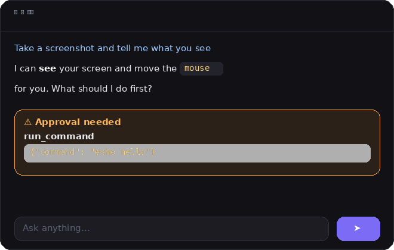

<div align="center">


# Agent KH

### A tiny friend that lives at the top of your screen — and actually does things for you.


*He blinks. He breathes. He watches your cursor.*

Chat with him, watch him work, approve his actions — all from the island.
No browser tabs, no terminal windows, no fuss.

[](https://github.com/Nikankh566/AgentKH/releases)


</div>

---

<div align="center">

## ✨ See it in action


*When he needs permission, the island glows orange and asks you.*


*Like iPhone's Dynamic Island — it shrinks to a mini pill when idle, springs open with live activities: equalizer when speaking 🔊, spinner when working ⚙️, countdown during pomodoro 🍅.*



*Click the island — it springs open. Chat with markdown, live activity, approval cards.*

</div>

---

## 💡 Why

AI assistants live in browser tabs you forget to open. **Agent KH lives on your screen** —
a little companion in a black island at the top, with eyes that follow your cursor.
He sees your screen, moves your mouse, types for you, runs commands, and asks
permission before anything sensitive. When a new version drops, he tells you himself
and updates in one click.

## 🚀 Features

<table>
<tr>
<td>🟣 <b>Island companion</b><br><sub>Soft little character at the top of your screen — eyes follow your cursor, blinks, breathes, waves hello</sub></td>
<td>✨ <b>Alive</b><br><sub>Springy animations, floating hearts on long hover, poke him (three pokes = dizzy!), falls asleep when idle, little chimes</sub></td>
</tr>
<tr>
<td>💬 <b>Chat in the island</b><br><sub>Click to expand — streaming replies with markdown, model switcher pill, slash commands</sub></td>
<td>✅ <b>Approvals</b><br><sub>Island glows orange — Allow / Always allow / Deny, with <code>Y</code>/<code>N</code> shortcuts</sub></td>
</tr>
<tr>
<td>🔄 <b>Self-updating</b><br><sub>New release? A card pops up — one click downloads & installs</sub></td>
<td>👁️ <b>Vision + control</b><br><sub>Sees your screen, moves mouse, types (EN/FA), hotkeys</sub></td>
</tr>
<tr>
<td>🔌 <b>MCP support</b><br><sub>Connect any Model Context Protocol server</sub></td>
<td>🧠 <b>Memory</b><br><sub>Remembers facts about you across sessions</sub></td>
</tr>
<tr>
<td>🔊 <b>Speaks to you</b><br><sub>Optional text-to-speech replies (EN/FA)</sub></td>
<td>⏰ <b>Reminders</b><br><sub>"Remind me in 10 minutes" — he pops up when time's up</sub></td>
</tr>
<tr>
<td>📝 <b>Quick notes</b><br><sub>"Note: buy milk" — saved locally, ask for them anytime</sub></td>
<td>📌 <b>Pin on top</b><br><sub>Keep the island above all windows</sub></td>
</tr>
</table>

> **Also:** 32-bit Windows builds, voice input 🎤, file attachments 📎, themes 🎨,
> quick actions ⚡, chat export 💾, reminders ⏰, pomodoro ⏱️ — see the [release notes](https://github.com/Nikankh566/AgentKH/releases/latest).

## 📥 Install

<div align="center">

### [⬇️ Download for 64-bit Windows](https://github.com/Nikankh566/AgentKH/releases/latest/download/AgentKH-Setup.exe)

*Latest release — free forever · [32-bit installer](https://github.com/Nikankh566/AgentKH/releases/latest/download/AgentKH-Setup-x86.exe) also available*

> **WebView2 problems?** Get the [**Qt edition**](https://github.com/Nikankh566/AgentKH/releases/latest/download/AgentKH-Qt-Setup.exe) — it bundles its own Chromium and needs **nothing** installed.

</div>

Run the installer — it installs to `%LOCALAPPDATA%\AgentKH`, adds a Start Menu
shortcut, and starts with Windows automatically.

> **Windows will show a warning the first time** — the installer isn't code-signed yet:
> click **More info** → **Run anyway**. This is expected for unsigned open-source installers.
>
> **Note:** Agent KH needs the free [Microsoft Edge WebView2 Runtime](https://developer.microsoft.com/microsoft-edge/webview2/)
> (most Windows 10/11 PCs already have it). The installer warns you if it's missing.

Prefer portable? Grab **AgentKH-Windows.zip**, extract anywhere, run `AgentKH.exe`.

### 🐧 Linux

Download **AgentKH-Linux.tar.gz**, extract and run:

```bash
tar -xzf AgentKH-Linux.tar.gz
./AgentKH-Qt/AgentKH-Qt
```

### 🍎 macOS (Apple Silicon)

Download **AgentKH-macOS.zip**, extract and run `AgentKH/AgentKH`.
> If macOS blocks it: right-click → Open (unsigned app, first launch only).

## 🎮 Using it

| What you do | What happens |
|---|---|
| Click the island | It springs open: chat, activity, settings |
| Type and hit Enter | He thinks, works, and streams the answer |
| He needs permission | The island glows orange 🟠 — Allow / Always / Deny (or `Y` / `N`) |
| Hover him 2 sec | Hearts 💕 |
| Click him | He gets annoyed 😠 — three times → dizzy 😵 |
| Leave him 45 sec | He falls asleep 💤 |
| New version out | Card pops up — one click updates 🔄 |

Add your Gemini API key in ⚙️ Settings
(free at [aistudio.google.com](https://aistudio.google.com) — no credit card),
or point him at any OpenAI-compatible API.

Slash commands: `/new` · `/model` · `/screenshot`

## 🆕 What's new

- **v5.1** — 🐧 Linux + 🍎 macOS builds! (Qt edition on Linux, native WKWebView on Mac)
- **v5.0** — **Qt edition** 🖥️: same app, zero WebView2 dependency (bundled Chromium)
- **v4.4.1** — startup hardening: clean error dialog if WebView2 is missing
- **v4.4** — Dynamic Island 🏝️: morphs mini/compact, live activities (speaking 🔊, working ⚙️, pomodoro 🍅)
- **v4.3** — chat history 💾, mochi colors 🎨, personality presets 🎭, pomodoro timer ⏱️
- **v4.2** — speaks replies 🔊, reminders ⏰, quick notes 📝, pin-on-top 📌, **32-bit builds**
- **v4.1** — voice input 🎤, file attachments 📎, theme colors 🎨, quick actions, chat export 💾
- **v4.0** — brand-new web UI (HTML/CSS): buttery animations, cuter character, real glow effects
- **v3.2** — fixed the approval glow and badge, smoother island outline
- **v3.1** — self-updater, custom icon, markdown chat, slash commands
- **v3.0** — animations everywhere: springy island, hearts, poke, sleep, sounds

## 🔨 Build it yourself

```bat
build.bat
```
PyInstaller (`AgentKH.spec`) → `dist\AgentKH\AgentKH.exe`, then `makensis installer.nsi`.
GitHub Actions builds everything on every `v*` tag.

From source (Python 3.9+):
```bash
git clone https://github.com/Nikankh566/AgentKH.git
cd AgentKH
pip install pywebview pillow
python agentkh.py
```

## 🔒 Privacy

- Runs **locally** — only your prompts (and screenshots you ask for) go to the LLM API
- Your API key stays in your local `config.json`, never uploaded anywhere
- Approval prompts for every sensitive action; auto-approve is off by default
- Update checks only ask GitHub's API for the latest release tag — no telemetry

## 📁 Project layout

| File | What it is |
|---|---|
| `agentkh.py` | App shell: pywebview window + Python↔JS bridge |
| `web/ui.html` | The whole UI: island, character (SVG), chat/activity/settings, cards |
| `engine.py` | Agent core: LLM client, tools, agent loop |
| `sfx.py` | Little synthesized sounds |
| `updater.py` | Self-update: check, download, install |
| `desktop.py` | Mouse/keyboard/screenshot |
| `mcp.py` | MCP stdio client |
| `soul.md` | Editable personality |

## 📄 License

MIT — free for personal and commercial use. See [LICENSE](LICENSE).

---

<details>
<summary>🇮🇷 فارسی</summary>

<div align="center">

</div>

**Agent KH** یه دوست کوچیک هوش مصنوعیه که بالای صفحه‌ت زندگی می‌کنه — یه جزیره‌ی
مشکی با یه کاراکتر بامزه که چشماش دنبالت می‌کنه، پلک می‌زنه و نفس می‌کشه.
روش کلیک کن تا چت باز بشه؛ بدون مرورگر، همه‌چیز توی همون جزیره اتفاق می‌افته.

**امکانات:** انیمیشن‌های نرم، قلب با هاور، poke کردن، خوابیدن، صدا، تأیید با
درخشش نارنجی، آپدیت خودکار با یه کلیک، حافظه بلندمدت، MCP و فارسی.

از صفحه‌ی [Releases](https://github.com/Nikankh566/AgentKH/releases) فایل
**AgentKH-Setup.exe** رو دانلود و نصب کن — رایگان، برای همیشه.

</details>
