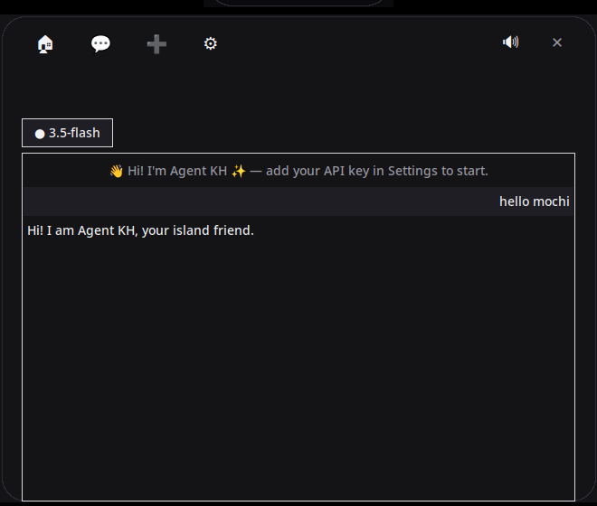
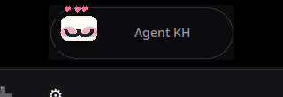
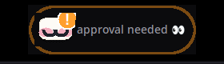

<div align="center">


# Agent KH

**A tiny friend that lives at the top of your screen — and actually does things for you.**

Chat with him, watch him work, approve his actions — all from the island. No browser, no terminal, no fuss.

[](https://github.com/Nikankh566/AgentKH/releases)




</div>

---

## Why

AI assistants live in browser tabs you forget to open. **Agent KH lives on your screen** —
a little Mochi-style friend in a black island at the top, with eyes that follow your
cursor. He sees your screen, moves your mouse, types for you, runs commands, and asks
permission before anything sensitive. When a new version drops, he tells you himself
and updates in one click.

## Features

- 🟣 **Island companion** — a soft little character at the top of your screen: eyes follow your cursor, blinks, breathes, waves hello, celebrates when he's done
- ✨ **Alive** — springy animations, floating hearts on long hover, poke him (three pokes = dizzy!), falls asleep when idle, little chimes
- 💬 **Chat in the island** — click to expand; streaming replies with markdown, click the model pill to switch models
- 📋 **Live activity feed** — watch every step: what he reads, runs and clicks
- ✅ **Approvals in the island** — Allow / Always allow / Deny, with `Y` / `N` keyboard shortcuts
- 🔄 **Self-updating** — when a new release drops, a card appears in the island; one click downloads and installs it
- 👁️ **Vision** — screenshots so he can actually *see* buttons, windows and dialogs
- 🖱️ **Full mouse control** — move, click, double-click, scroll, drag
- ⌨️ **Full keyboard control** — type (English/Persian), keys, hotkeys like Win+R
- 🔌 **MCP support** — connect any [Model Context Protocol](https://modelcontextprotocol.io) server and use its tools
- 🧠 **Long-term memory** — remembers facts about you across sessions
- 🎭 **Editable personality** — `soul.md`, editable from Settings
- 🌐 **Bilingual** — English by default, one tap for فارسی
- 🖥️ **Drag him out** — tear Mochi off the island onto your desktop; double-click sends him home




## Install

Download **[AgentKH-Setup.exe](https://github.com/Nikankh566/AgentKH/releases/latest)**
from the Releases page and run it. It installs to `%LOCALAPPDATA%\AgentKH`,
adds a Start Menu shortcut, and starts with Windows automatically.

> **Windows will show a warning the first time** — the installer isn't code-signed yet:
> click **More info** → **Run anyway**. This is expected for unsigned open-source installers.

Prefer portable? Grab **AgentKH-Windows.zip**, extract anywhere, run `AgentKH.exe`.

## Using it

| What you do | What happens |
|---|---|
| Click the island | It springs open: chat, activity, settings |
| Type and hit Enter | He thinks, works, and streams the answer |
| He needs permission | The island glows orange, a card appears: Allow / Always / Deny (or press `Y` / `N`) |
| Hover him for 2 seconds | Hearts 💕 |
| Click him | He gets annoyed. Three times → dizzy 😵 |
| Drag him out of the island | He moves onto your desktop. Double-click sends him home |
| Leave him alone for 45s | He falls asleep 💤 (click to wake) |
| A new version is released | A card pops up in the island — one click updates |

Add your Gemini API key in ⚙️ Settings
(free at [aistudio.google.com](https://aistudio.google.com) — no credit card),
or point him at any OpenAI-compatible API.

## Build it yourself

On Windows:
```bat
build.bat
```
Runs PyInstaller (`AgentKH.spec`) → `dist\AgentKH\AgentKH.exe`.
Setup wizard: `makensis installer.nsi`.
GitHub Actions builds the installer + portable zip on every `v*` tag.

From source (Python 3.9+, tkinter):
```bash
git clone https://github.com/Nikankh566/AgentKH.git
cd AgentKH
pip install pillow          # optional, enables vision
python agentkh.py
```

## Privacy

- Runs **locally** — only your prompts (and screenshots you ask for) go to the LLM API
- Your API key stays in your local `config.json`, never uploaded anywhere
- Approval prompts for every sensitive action; auto-approve is off by default
- Update checks only ask GitHub's API for the latest release tag — no telemetry

## Project layout

| File | What it is |
|---|---|
| `agentkh.py` | Island app: Mochi, chat/activity/settings, approvals, updater UI |
| `engine.py` | Agent core: LLM client, tools, agent loop |
| `mochi.py` | Mochi character (canvas animation) |
| `sfx.py` | Little synthesized sounds |
| `updater.py` | Self-update: check, download, install |
| `desktop.py` | Mouse/keyboard/screenshot (pyautogui or Win32) |
| `mcp.py` | MCP stdio client |
| `soul.md` | Editable personality |

## License

MIT — free for personal and commercial use. See [LICENSE](LICENSE).

---

<details>
<summary>🇮🇷 فارسی</summary>

**Agent KH** یه دوست کوچیک هوش مصنوعیه که بالای صفحه‌ت زندگی می‌کنه — یه جزیره‌ی
مشکی با یه کاراکتر بامزه که چشماش دنبالت می‌کنه. روش کلیک کن تا چت باز بشه؛
بدون مرورگر، همه‌چیز توی همون جزیره اتفاق می‌افته. صفحه رو می‌بینه، موس و
کیبورد رو کنترل می‌کنه، دستور اجرا می‌کنه، و قبل از هر کار حساسی اجازه می‌گیره.
نسخه‌ی جدید که بیاد خودش خبرت می‌کنه و با یه کلیک آپدیت می‌شه.
از صفحه‌ی [Releases](https://github.com/Nikankh566/AgentKH/releases) فایل
`AgentKH-Setup.exe` رو دانلود و نصب کن.
</details>
